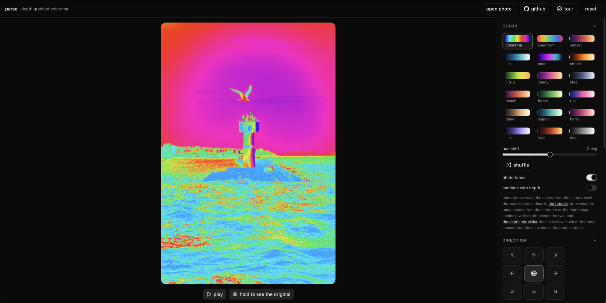

# parse

A React + WebGL shader that recolors a photo with an After Effects Colorama style cycle, then wipes it away with a gradient transition that reveals the original underneath. The transition is modelled on the [SaaS gradient transition tutorial](https://www.youtube.com/watch?v=JQ85g-OTy50) (sheikh sohel on YouTube).

## run

    npm install
    npm run dev        # localhost:5173
    npm run depth      # regenerate the depth map (first run downloads the model)
    npm run build      # single file bundle in dist/index.html

## how it all works

### the effect

Every pixel gets a value from 0 to 1, and that value picks a color off a 256 step gradient strip, the same idea as After Effects Colorama. The interesting part is what decides the value:

- position: the direction pad sweeps the strip across the frame, or blooms it radially from the center dot
- depth: the scene's distance map, near to far laid across the strip
- the photo itself: each pixel's own brightness, the classic gradient map trick, which is the photo tones switch
- blends of those: combine with depth mixes tones and map, and the depth mix slider sets the share

Then a wipe reveals the untouched original underneath. The front has a soft edge (softness), it can blur the input mid sweep like the tutorial's animated box blur (sweep blur), and the palette can roll its colors as it travels. Dither (bayer or noise) breaks the ramp into ordered dots right before the posterize step, which is the print look. Steps posterizes the ramp into flat bands.

### the two depth maps

The bundled photo ships with its depth pre baked at build time, not computed at runtime:

- `npm run depth` runs Depth Anything V2 (large, q8) in Node through transformers.js and writes `src/assets/depth.png`, the detailed map that drives the colors
- it also writes `depth-soft.png`, a heavily smoothed copy run through histogram equalization. The reveal front reads that one, so the wipe sweeps the whole scene consistently, and slider position equals revealed area: 50% on the slider uncovers 50% of the pixels

### the model that never downloads

When you load your own photo, the site posts it to `/api/depth`, a Vercel serverless function. The quantized model (q8, about 26 MB of ONNX weights) ships inside the function's own bundle, in `models/`, so:

- visitors download nothing, ever. The browser sends a JPEG (up to 1024px on the long side) and gets back a depth PNG of about 60 KB, marked no-store
- the model runs on CPU inside the function, about 6 seconds on a cold start and 4.6 seconds warm, one photo at a time
- the weights are Apache 2.0, which is what makes shipping them in the repo possible
- if the function is unreachable, or you run the local file build, the browser falls back to running the same small model itself through transformers.js, WebGPU first, wasm after. Nothing breaks, that visitor just pays a one time download instead

q8 was picked over fp16 (47 MB) and q4 (18 MB): half the weight of the big one, and a better map than the small one.

### keeping the endpoint to ourselves

The function is the only piece here that costs compute, so it refuses to be someone else's free depth API. Four layers, cheapest first:

- same origin only: browsers always send Origin on the site's own posts, so anything without it is not our page. The browser's own fetch signals (Sec-Fetch-Site and Referer) have to line up too. Another website's JavaScript cannot call it, and a bare curl gets a 403
- bodies over 10 MB are refused before they cost memory (Vercel itself caps request bodies around 4.5 MB)
- each address gets 15 depth runs per 10 minutes, per warm function instance
- every request must carry a small proof of work: a nonce such that sha256(prefix : hour : sha256 of the exact photo bytes, then nonce) starts with 19 zero bits. The browser solves that in about 300 ms, invisible next to the 4 to 6 second model run, but a flood pays that compute for every single request. The challenge includes a hash of the exact body and the hour, so a solved nonce cannot be replayed or reused on another photo

The sha256 for this is hand rolled in `src/lib/pow.js` and shared by the client and the function so both sides run identical math. It is fuzz tested against Node's crypto.

### exports

- png: re-renders at the buffer's full resolution and saves
- video: records the sweep through WebCodecs in quality mode, H.264 at 40 Mbps, frames rendered on a fixed 60fps clock and muxed to mp4 with mp4-muxer. The realtime MediaRecorder path stays as the fallback
- loop: records the animate cycle for a whole number of palette rounds (the loop length slider), so the first and last frames match and the clip repeats without a seam

## controls

- direction: eight ramp axes plus a radial mode. invert flips the ramp and the reveal order.
- depth mix: 0 keeps the ramp positional, 1 reads it entirely from the depth map. photo tones reads the ramp from the photo itself instead, the way colorama does in the tutorial; combine with depth blends the two and lets the depth mix slider share the ramp between the tones and the map. the use depth map switch turns depth off: the ramp and the reveal then run on tone, position, and direction alone, and no depth pass or server call happens.
- reveal: the gradient wipe. the front runs through the chosen direction by default, blooming out of the middle on the center dot, revealing the original underneath; slide wipe source toward the depth map for a wipe that follows the scene's depth instead. play runs the sweep, the slider scrubs it.
- softness: how wide the transition edge is. sweep blur: a gentle blur that peaks halfway and cleans up at both ends, like the animated box blur in the tutorial. roll colors cycles the palette while the sweep runs.
- ramp: cycles, phase, posterize steps, and a loop toggle that wraps the ramp.
- dither: patterns the ramp just before the posterize step, so stacked colors break into ordered dots. bayer or noise, with amount and cell size. switching it on raises steps to 8 for the classic look.
- palette: eighteen color cycles with a hue shift on top, plus a shuffle button that picks a combo for you. colorama is the default.
- motion: scrolls the ramp over time.
- holding the photo or the pill under it shows the untouched original for as long as you hold.
- open photo: loads any image at any size, or drop one straight on the canvas. oversized photos are scaled down to the gpu texture limit, and a fresh photo gets a quick depth estimate instantly while the small model refines it on the server.
- tour: the button in the top bar walks every control in 42 stops, opening collapsed sections as it goes.
- export png renders at the photo's full size. save map writes the grayscale texture the shader feeds on.
- export video records the sweep in quality mode, frame paced at a fixed 60fps and encoded off the clock, muxed straight to mp4; the realtime recorder remains the fallback. export loop records the animate cycle for whole palette rounds, so the clip repeats without a seam. loop length sets how long it runs.

## deploy

The repo is public on GitHub (sloemo01/parse) and deploys to Vercel as a static Vite site at https://parse-sloemos-projects.vercel.app, with one serverless function (api/depth.js) that runs the depth model. Visitors download nothing but the app itself; the browser falls back to its own copy of the model only when the endpoint is unreachable. The function answers same origin POSTs only, caps the body at 10 MB, throttles each address to fifteen runs per ten minutes, and asks for a small proof of work bound to the exact photo bytes and the hour, so a flood pays compute per request and a solved nonce is useless anywhere but that one photo.

## repo map

    src/gl/shaders.js       the whole fragment shader: ramp, wipe, dither, posterize
    src/gl/renderer.js      WebGL setup, texture uploads, export sizing
    src/lib/palettes.js     the 18 palettes and the 256 step LUT builder
    src/lib/depth.js        quick depth estimate and soft map, browser side
    src/lib/depthAI.js      server depth call, browser model fallback ladder
    src/lib/pow.js          sha256 and proof of work, shared by both sides
    src/lib/videoExport.js  WebCodecs encoder with mp4 muxing
    src/components/         the panel, direction pad, ui primitives, the tour
    api/depth.js            the serverless depth function
    tools/build-depth.mjs   the offline depth bake
    models/                 the quantized weights the function carries

## notes

- The built file accepts query params for deep linking a state, for example ?wipe=0.5&wipesource=0&palette=neon. add depthmap=0 to land with the depth map switched off, or combine=1 for the tones and depth blend on.
- The bundled photo is resized to 1600 x 2400 to keep the single file build light. Replace the file in src/assets and the shader picks up the new size on its own.
- photo: Kaplan Art on Pexels.

## honest limits

- cold starts: the first depth run after the function has gone quiet takes about 6 seconds, then it is warm
- the throttle is per warm instance, not global. A large distributed flood is Vercel's DDoS layer's job, not this function's
- the bundled photo's depth is large model quality; uploaded photos get the small model, same family, lighter sibling

## license

MIT, see [LICENSE](LICENSE). The depth weights bundled in models/ are Apache 2.0, from Depth Anything V2; the bundled photo is Kaplan Art on Pexels under the Pexels license.
